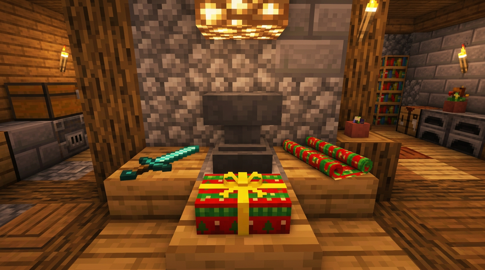

# Geschenke einpacken

Mit einer **Geschenkrolle** wickelst du ein einzelnes Item in Geschenkpapier. Das Geschenk kannst du verschenken. Wer es auspackt, bekommt genau das Item zurück, das du eingepackt hast.

<figure><figcaption>
Im Amboss wird aus Item und Geschenkrolle ein Geschenk
</figcaption></figure>

## So packst du ein

1. Lege das Item in das linke Feld eines Ambosses.
2. Lege die Geschenkrolle in das rechte Feld.
3. Nimm das Geschenk aus dem Ergebnisfeld.

Die Geschenkrolle bestimmt das Aussehen des Geschenks. Auf dem Geschenk steht, wer es eingepackt hat.


Im Textfeld des Ambosses kannst du einen eigenen Namen eintragen. Das Geschenk trägt dann diesen Namen. Lässt du den Namen des Items stehen, heißt das Ergebnis einfach Geschenk.



Eingepackt wird immer nur **ein** Item. Stapel, Kisten, Shulker-Kisten, Bündel und bereits eingepackte Geschenke lassen sich nicht einwickeln.


## So packst du aus

1. Halte das Geschenk in der Hand.
2. Klicke mit Rechtsklick, um es auszupacken.
3. Das eingepackte Item landet in deinem Inventar. Das Geschenkpapier ist danach weg.


Ist dein Inventar voll, lässt sich das Geschenk nicht auspacken. Schaffe zuerst einen freien Platz.



Verzauberungen, Namen und andere Eigenschaften des Items bleiben beim Einpacken erhalten und kommen beim Auspacken wieder.

